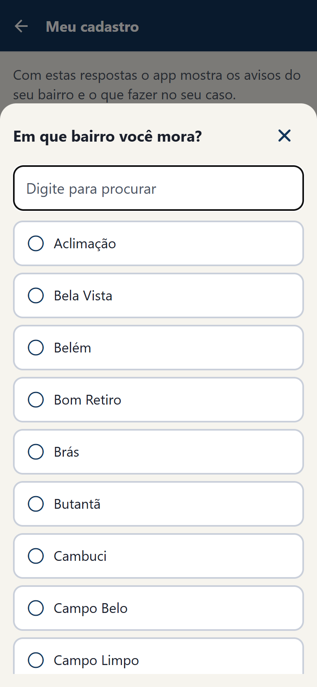
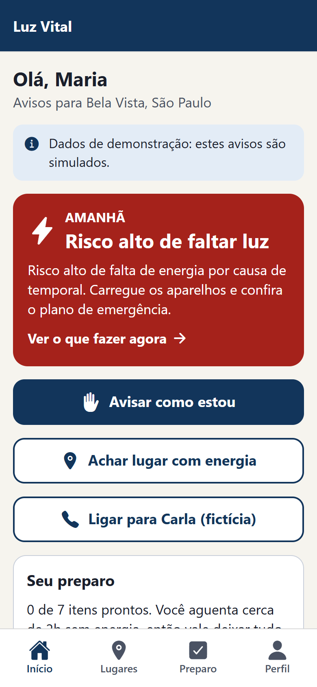
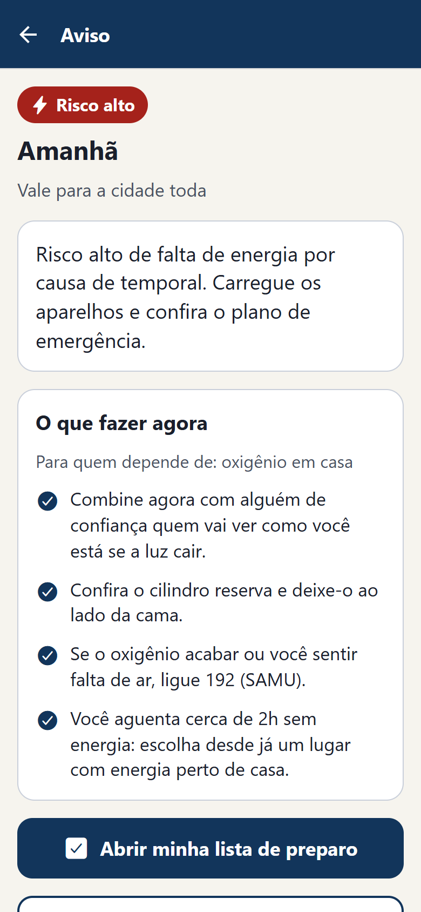
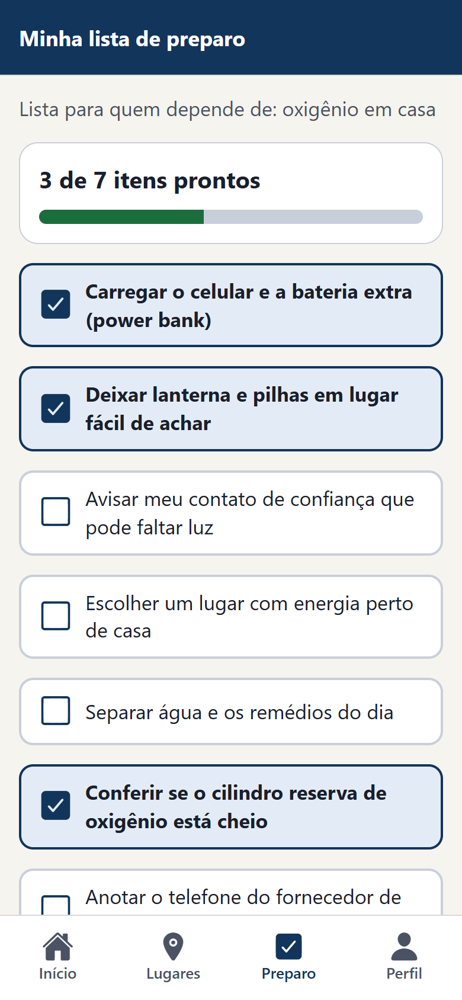
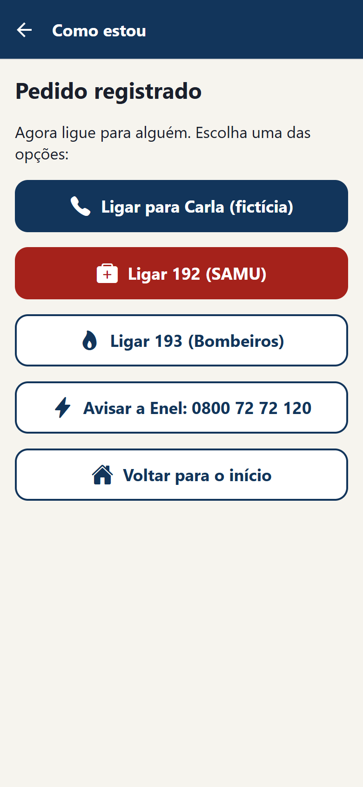
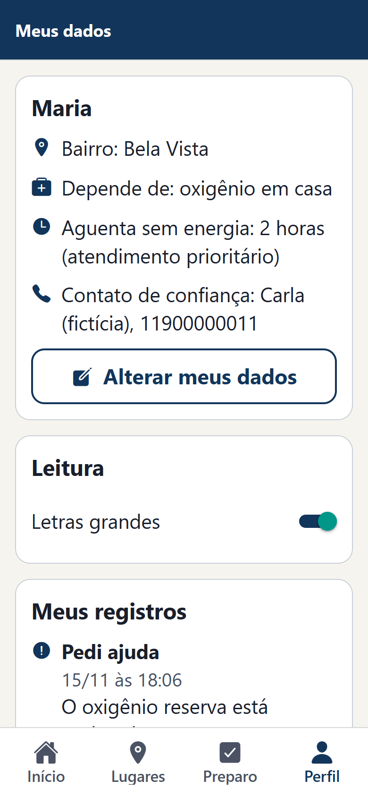
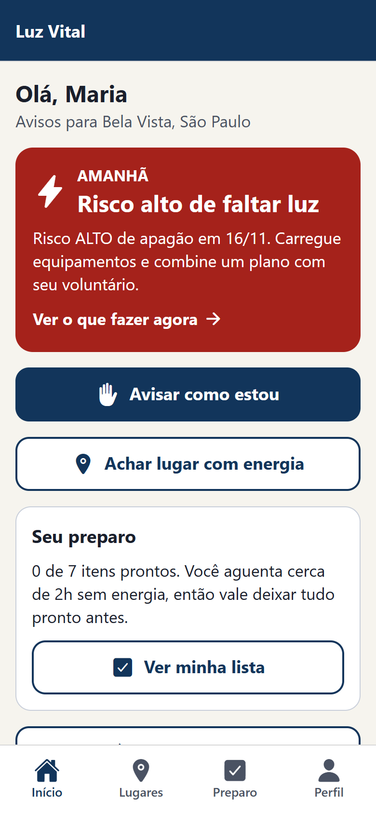

# Luz Vital - App do cidadão (Mobile Development & IOT)

Global Solution CitizenTech, FIAP 2026.2, Engenharia de Software

App em Expo (React Native + TypeScript + Expo Router) para quem depende de energia em casa. Por ele o cidadão recebe o aviso de risco de apagão do seu bairro, vê o que fazer no seu caso, acha um lugar com energia por perto e registra como está.

**Vídeo:** https://youtu.be/3Zgiv1VxC4s

## Ficha da CitizenTech

| Campo | Conteúdo |
| --- | --- |
| Nome | Luz Vital |
| Cidade e bairro | São Paulo, área de concessão da Enel SP |
| Cidadão beneficiado | Quem depende de energia em casa (oxigênio domiciliar, insulina na geladeira, cadeira motorizada, idoso acamado) e quem cuida dessas pessoas |
| Problema, em uma frase | Quando um temporal derruba a energia, quem depende dela para viver não é avisado antes, não sabe quanto tempo vai ficar sem luz nem onde achar uma tomada, e ninguém vai checar se está bem |
| Como funciona | Um modelo treinado com dados do INMET e da ANEEL prevê os dias de risco de apagão. O app avisa os cadastrados com antecedência, aciona vizinhos voluntários para checar essas pessoas e mostra pontos com energia por perto |
| O que cada parte faz | `api-csharp/`: cidadãos, voluntários, alertas e check-ins; [serviço de pontos](https://github.com/arthurrmenezes/gs-soa): pontos com energia; **app do cidadão (este repositório)**; [luzvital-ml](https://github.com/Caiorasuckkk/luzvital-ml): previsão do dia de risco; `cyber/`: proteção dos dados de saúde; `docs/`: requisitos e testes |
| Link do repositório | https://github.com/Caiorasuckkk/luzvital |
| Indicador de impacto | % de cadastrados avisados pelo menos 12h antes de um dia de risco e tempo até o primeiro check-in depois que a luz cai |
| ODS conectados | 3, 7, 10, 11 e 13 |

## Integrantes

- Arthur Albuquerque RM 562950
- Caio Rasuck RM 93645

## Jornada do cidadão

1. Faz um cadastro curto: nome, bairro, do que depende e quanto tempo aguenta sem energia.
2. Na tela inicial vê o risco de faltar luz no seu bairro, com dia, nível e mensagem.
3. Abre o aviso e lê o que fazer, de acordo com a sua necessidade.
4. Marca a lista de preparo antes do dia de risco.
5. Procura um lugar com energia perto de casa e salva os que interessam.
6. Se a luz cair, registra "estou bem" ou "preciso de ajuda" e liga para o contato de confiança, o SAMU, os Bombeiros ou a Enel com um toque.

## Como rodar

Precisa do [Node.js](https://nodejs.org) 20 ou mais novo.

```bash
npm install
npx expo start
```

Depois leia o QR code com o Expo Go (Android) ou a câmera (iOS), ou tecle `a` (emulador Android) ou `w` (navegador). Sem configurar nada, o app usa os dados de demonstração.

### Com as APIs (opcional)

Copie `.env.example` para `.env`, suba as APIs e reinicie o app com `npx expo start --clear`.

| Variável | API | Como subir |
| --- | --- | --- |
| `EXPO_PUBLIC_API_URL` (porta 5131) | Alertas: `api-csharp/` do [repositório principal](https://github.com/Caiorasuckkk/luzvital) | `dotnet run --project src/LuzVital.Api` |
| `EXPO_PUBLIC_PONTOS_URL` (porta 5132) | Lugares: [serviço de pontos](https://github.com/arthurrmenezes/gs-soa) | `dotnet run --project src/LuzVital.Pontos.Api` |

O endereço depende de onde o app roda: `http://localhost:PORTA` no navegador, `http://10.0.2.2:PORTA` no emulador Android e `http://IP-DO-COMPUTADOR:PORTA` no celular.

Para aparecer um alerta, envie uma previsão de risco à API de alertas (troque a data por hoje ou um dia futuro):

```http
POST http://localhost:5131/api/previsoes
{ "data": "2026-11-20", "probabilidade": 0.82, "versaoModelo": "xgb-v1" }
```

## Consumo de dados

Tudo em `src/services/api.ts`.

| Dado | Origem |
| --- | --- |
| Alertas de risco | `GET /api/alertas?bairro=` da API C#. Sem a API configurada, mock no mesmo formato |
| Lugares com energia | `GET /api/pontos` do serviço de pontos. Sem ele, mock com os mesmos lugares (`src/dados/pontos.mock.json`) |

A tela sempre diz de onde o dado veio. Se a API de alertas cair, o app mostra a última cópia gravada no banco, com o aviso "Sem conexão".

## Banco de dados

SQLite no aparelho, com `expo-sqlite` (`src/db/banco.ts`).

| Tabela | O que guarda |
| --- | --- |
| `perfil` | Cadastro do cidadão |
| `preferencias` | Opção "Letras grandes" e a hora da última busca de alertas |
| `preparo` | Itens marcados na lista de preparo |
| `registros` | Histórico de "estou bem" e "preciso de ajuda" |
| `alertas_cache` | Cópia dos últimos alertas, para o app funcionar sem internet |
| `pontos_favoritos` | Lugares salvos |

## Acessibilidade

- Linguagem simples e frases curtas, sem termos técnicos.
- Letras de 16 pt para cima, opção "Letras grandes" (25% maior) e respeito ao tamanho de fonte do sistema.
- Contraste de pelo menos 4,5:1 e botões com pelo menos 56 pt de altura.
- O nível de risco nunca depende só da cor: vem sempre com ícone e texto.
- Rótulos, dicas e estados de acessibilidade nos botões, opções e caixas de marcar, para o TalkBack e o VoiceOver.
- Erros do formulário escritos ao lado do campo, dizendo como corrigir.
- Escolhas por botões grandes no lugar de digitação; o bairro abre uma lista com busca que ignora acentos.

## Dados pessoais

O cadastro, a lista e os registros ficam só no aparelho e podem ser apagados em "Meus dados". O app não pede CPF nem endereço. Os alertas, os lugares e os nomes usados nos prints são fictícios.

## Telas

As telas ficam em `src/app/` (Expo Router). Prints tirados com o app rodando no navegador, em tamanho de celular.

| Boas-vindas | Cadastro | Lista de bairros |
| --- | --- | --- |
|  |  |  |

| Início | Aviso | Lista de preparo |
| --- | --- | --- |
|  |  |  |

| Lugares com energia | Detalhe do lugar | Como estou |
| --- | --- | --- |
|  |  |  |

| Pedido de ajuda | Meus dados, com letras grandes | Início com a API C# |
| --- | --- | --- |
|  |  |  |

| Início sem conexão |
| --- |
|  |

## Uso de IA

Registrado em [prompts.md](prompts.md).
