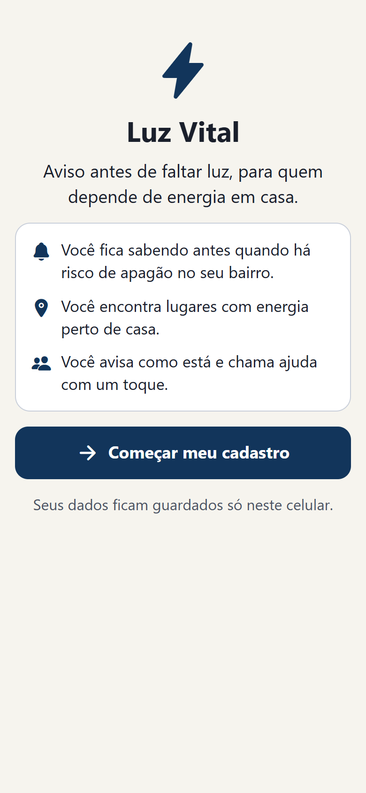
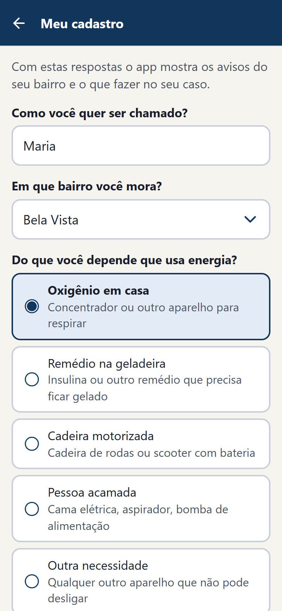
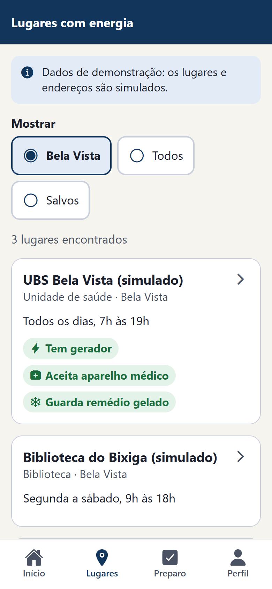
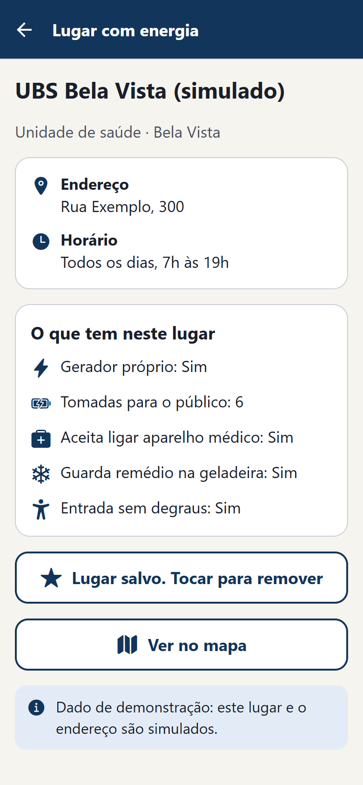
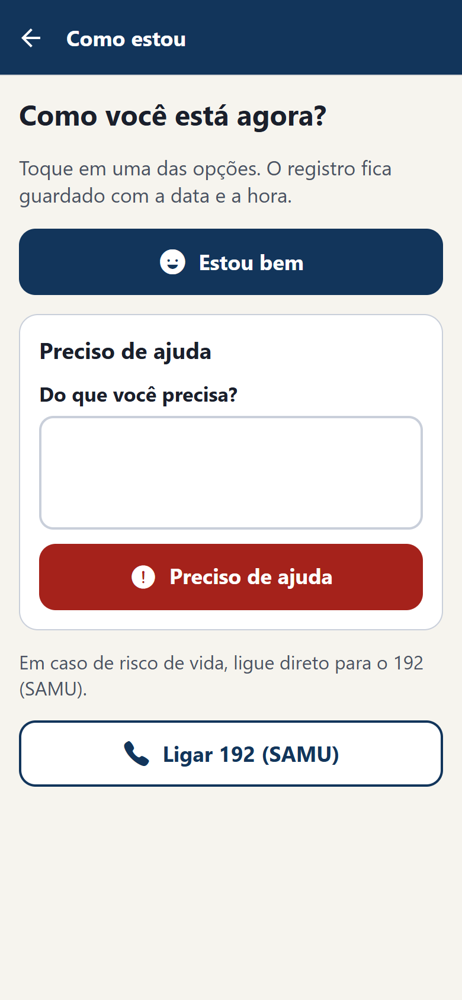
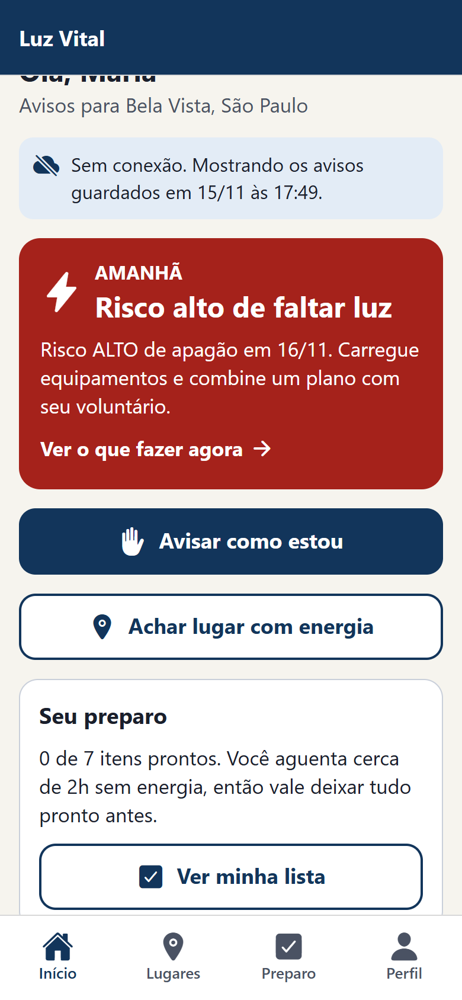

# Luz Vital - App do cidadão (Mobile Development & IOT)

Global Solution CitizenTech, FIAP 2026.2, Engenharia de Software

App em Expo (React Native + TypeScript + Expo Router) para quem depende de energia em casa. Por ele o cidadão recebe o aviso de risco de apagão do seu bairro, vê o que fazer no seu caso, acha um lugar com energia por perto e registra como está.

## Ficha da CitizenTech

| Campo | Conteúdo |
| --- | --- |
| Nome | Luz Vital |
| Cidade e bairro | São Paulo, área de concessão da Enel SP |
| Cidadão beneficiado | Quem depende de energia em casa (oxigênio domiciliar, insulina na geladeira, cadeira motorizada, idoso acamado) e quem cuida dessas pessoas |
| Problema, em uma frase | Quando um temporal derruba a energia, quem depende dela para viver não é avisado antes, não sabe quanto tempo vai ficar sem luz nem onde achar uma tomada, e ninguém vai checar se está bem |
| Como funciona | Um modelo treinado com dados do INMET e da ANEEL prevê os dias de risco de apagão. O app avisa os cadastrados com antecedência, aciona vizinhos voluntários para checar essas pessoas e mostra pontos com energia por perto |
| O que cada parte faz | `api-csharp/`: cidadãos, voluntários, alertas e check-ins; serviço de pontos (C#, entrega de SOA): pontos com energia; `mobile/`: app do cidadão (este repositório); [luzvital-ml](https://github.com/Caiorasuckkk/luzvital-ml): previsão do dia de risco; `cyber/`: proteção dos dados de saúde; `docs/`: requisitos e testes |
| Link do repositório | https://github.com/Caiorasuckkk/luzvital |
| Indicador de impacto | % de cadastrados avisados pelo menos 12h antes de um dia de risco e tempo até o primeiro check-in depois que a luz cai |
| ODS conectados | 3, 7, 10, 11 e 13 |

## Integrantes

- Arthur Albuquerque RM 562950
- Caio Rasuck RM 93645

## Vídeo

https://youtu.be/3Zgiv1VxC4s

## Jornada do cidadão

1. Faz um cadastro curto: nome, bairro, do que depende e quanto tempo aguenta sem energia.
2. Na tela inicial vê o risco de faltar luz no seu bairro, com dia, nível e mensagem.
3. Abre o aviso e lê o que fazer, de acordo com a sua necessidade (oxigênio, remédio gelado, cadeira motorizada etc.).
4. Marca a lista de preparo antes do dia de risco.
5. Procura um lugar com energia perto de casa e salva os que interessam.
6. Se a luz cair, registra "estou bem" ou "preciso de ajuda" e liga para o contato de confiança, o SAMU, os Bombeiros ou a Enel com um toque.

## Como rodar

Precisa do [Node.js](https://nodejs.org) 20 ou mais novo.

```bash
npm install
npx expo start
```

Com o servidor no ar:

- celular: leia o QR code com o Expo Go (Android) ou com a câmera (iOS)
- emulador Android: tecle `a`
- navegador: tecle `w`

Sem configurar nada, o app usa os dados de demonstração (mock).

### Com a API C# da Luz Vital

O app lê os alertas de `GET /api/alertas?bairro=` da API que está em `api-csharp/` no repositório principal.

```bash
# terminal 1, na pasta api-csharp do repositório principal
dotnet run --project src/LuzVital.Api

# terminal 2, nesta pasta
cp .env.example .env        # ajuste o endereço se precisar
npx expo start --clear
```

O endereço fica em `EXPO_PUBLIC_API_URL`:

| Onde o app roda | Endereço |
| --- | --- |
| Navegador | `http://localhost:5131` |
| Emulador Android | `http://10.0.2.2:5131` |
| Celular na mesma rede | `http://IP-DO-COMPUTADOR:5131` |

Para aparecer um alerta, mande uma previsão com risco de 0,4 ou mais (troque a data por hoje ou um dia futuro):

```http
POST http://localhost:5131/api/previsoes
{ "data": "2026-11-20", "probabilidade": 0.82, "versaoModelo": "xgb-v1" }
```

### Com o serviço de pontos (entrega de SOA)

A aba "Lugares" lê `GET /api/pontos` do serviço de pontos com energia, que fica no repositório da entrega de SOA.

```bash
# terminal 1, na pasta do repositório de SOA
dotnet run --project src/LuzVital.Pontos.Api

# terminal 2, nesta pasta: no .env, defina EXPO_PUBLIC_PONTOS_URL=http://localhost:5132
npx expo start --clear
```

Vale a mesma tabela de endereços acima, trocando a porta para `5132`. Com o serviço no ar, o detalhe do lugar mostra também como ele está agora (aberto, lotado, sem energia ou fechado) e as tomadas livres.

Verificações:

```bash
npm run typecheck
npx expo-doctor
```

## Consumo de dados

| Dado | Origem | Onde no código |
| --- | --- | --- |
| Alertas de risco | API C# (`/api/alertas`) quando `EXPO_PUBLIC_API_URL` está definida; senão, mock no mesmo formato | `src/services/api.ts` |
| Lugares com energia | Serviço de pontos (`/api/pontos`) quando `EXPO_PUBLIC_PONTOS_URL` está definida; sem ela, ou se o serviço não responder, mock (`src/dados/pontos.mock.json`) com os mesmos lugares | `src/services/api.ts` |

A tela sempre diz de onde o dado veio: "Dados de demonstração" para o mock e "Sem conexão. Mostrando os avisos guardados em..." quando a API não responde. Nesse caso o app mostra a última cópia gravada no banco.

## Banco de dados

SQLite no aparelho, com `expo-sqlite`. O esquema e as consultas ficam em `src/db/banco.ts`.

| Tabela | O que guarda |
| --- | --- |
| `perfil` | Cadastro do cidadão (uma linha) |
| `preferencias` | Opção "Letras grandes" e a hora da última busca de alertas |
| `preparo` | Itens marcados na lista de preparo |
| `registros` | Histórico de "estou bem" e "preciso de ajuda", com data e hora |
| `alertas_cache` | Cópia dos últimos alertas, para o app funcionar sem internet |
| `pontos_favoritos` | Lugares salvos |

## Acessibilidade

- Linguagem simples e frases curtas, sem termos técnicos.
- Letras de 16 pt para cima, opção "Letras grandes" (25% maior) e respeito ao tamanho de fonte do sistema.
- Contraste de pelo menos 4,5:1 entre texto e fundo.
- Botões e opções com pelo menos 56 pt de altura.
- O nível de risco nunca depende só da cor: vem sempre com ícone e texto.
- `accessibilityRole`, `accessibilityLabel`, `accessibilityHint` e `accessibilityState` nos botões, opções, caixas de marcar e na chave, para o TalkBack e o VoiceOver.
- Erros do formulário escritos ao lado do campo, dizendo como corrigir.
- Escolhas por botões grandes no lugar de digitação. O bairro, que tem muitas opções, abre uma lista com busca que ignora acentos.

## Dados pessoais

O cadastro, a lista e os registros ficam só no aparelho e podem ser apagados em "Meus dados". O app não pede CPF nem endereço. Os alertas de demonstração, os lugares e os nomes usados nos prints são fictícios.

## Estrutura

```
src/
  app/                  telas (Expo Router)
    _layout.tsx         pilha principal, banco e contexto
    boas-vindas.tsx     primeira abertura
    cadastro.tsx        cadastro e edição do perfil
    situacao.tsx        "estou bem" ou "preciso de ajuda"
    alerta/[id].tsx     detalhe do aviso e o que fazer
    ponto/[id].tsx      detalhe de um lugar com energia
    (tabs)/             abas: início, lugares, preparo e meus dados
  components/ui.tsx     texto, botão, campo, opções e cartão acessíveis
  contexto/             perfil e preferência de leitura para o app todo
  dados/                regras do domínio e o mock dos lugares
  db/banco.ts           esquema e consultas do SQLite
  services/api.ts       API, mock e cópia local
  tema.ts, tipos.ts
docs/prints/            prints das telas
```

## Telas

Os prints foram tirados com o app rodando no navegador, em tamanho de celular.

| Boas-vindas | Cadastro | Início |
| --- | --- | --- |
|  |  |  |

| Aviso | Lista de preparo | Lugares com energia |
| --- | --- | --- |
|  |  |  |

| Detalhe do lugar | Como estou | Pedido de ajuda |
| --- | --- | --- |
|  |  |  |

| Lista de bairros |
| --- |
|  |

| Meus dados, com letras grandes | Início com a API C# | Início sem conexão |
| --- | --- | --- |
|  |  |  |

## Uso de IA

Registrado em [prompts.md](prompts.md).
